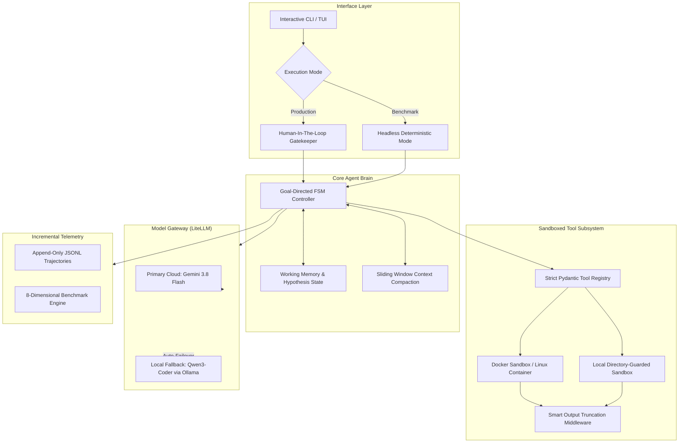

# Autonomous Software Engineering (SWE) Agent

> A production-grade, stateful autonomous software engineering agent built for deterministic repository inspection, reproduction, precision patching, and verification.

[](https://github.com)
[](https://docker.com)
[](https://deepmind.google)
[](https://swebench.com)

---

## 1. System Architecture

Unlike naive conversational agent swarms that suffer from severe context degradation and quadratic token inflation, this agent implements an **explicit Finite State Machine (FSM)** with isolated execution boundaries:



---

## 2. Engineering Paradigm: Single Agent vs. Multi-Agent

A key interview topic for AI/Agent Engineer roles is the architectural trade-off between **Single Stateful Agents** and **Multi-Agent Swarms**:

| Metric | Single Stateful Agent (Our Architecture) | Multi-Agent Swarm (ChatDev / AutoGen) |
| :--- | :--- | :--- |
| **State Grounding** | **High.** Single source of truth. Direct contact with compiler/tests. | **Fragile.** State degrades across inter-agent conversational message boundaries. |
| **SWE-bench Performance** | **Leaderboard Dominant.** Systems like SWE-agent, OpenHands, and Devin use single primary controllers. | **Consistently Lags.** Agents spend tokens discussing code rather than testing patches. |
| **Cost & Latency** | **Linear ($O(N)$).** Predictable token usage pruned by sliding window memory. | **Quadratic ($O(N^2)$).** Compounding context bloat from chat transcripts. |
| **Failure Recovery** | **Direct & Atomic.** Receives raw traceback, reverts git hunk, adjusts hypothesis. | **Diffused Responsibility.** Blame passed across agents in circular loops. |

**Production Takeaway**: Software engineering is an empirical feedback loop ($\text{Hypothesis} \to \text{Patch} \to \text{Test} \to \text{Traceback} \to \text{Verify}$). Intermediary conversational agents introduce latency and hallucinations. We reserve separate agents only for asymmetric boundaries (e.g. an independent, zero-context Red-Team Critic for the final diff).

---

## 3. Dual Execution Modes

The agent operates in two distinct operational modes:

1. **`PRODUCTION` Mode (Interactive + HITL)**:
   - Designed for software engineers pairing with the agent.
   - Interactive CLI with real-time status.
   - **Human-In-The-Loop Gatekeeper** intercepts destructive commands (`git push`, dependency installs, network access, file deletions) for confirmation before execution.
2. **`BENCHMARK` Mode (Headless + Autonomous)**:
   - Designed for unattended evaluation runs on benchmark sets.
   - 100% autonomous with zero human prompts.
   - Enforces **hard safety aborts**: any attempt to violate path or command restrictions causes immediate deterministic step rejection.

---

## 4. Evaluation Engine (8-Dimensional Metrics)

We evaluate agent performance against a **custom SWE-bench-inspired mini benchmark** (with a planned roadmap to official SWE-bench Lite):

- **1. Resolution Rate (`pass@1`)**: Percentage of repository tasks where both the reproduction script and test suite pass.
- **2. Regression Rate**: Percentage of pre-existing passing tests broken by the patch.
- **3. Spurious Edits Ratio**: Files modified outside the functional scope of the issue.
- **4. Patch Delta (Hunk Size)**: Lines added/deleted ratio (penalizing bloated diffs).
- **5. Tool Call Efficiency**: Total tool invocations and balance (Search vs. Edit vs. Test).
- **6. Wall-Clock Latency**: End-to-end execution duration.
- **7. Token & Cost Footprint**: Cumulative prompt/completion tokens and dollar cost.
- **8. Self-Recovery Rate**: Successful resolutions achieved after encountering an intermediate test failure.

> **Evaluation Integrity**: The evaluation manifest maintains frozen repo commits and problem statements. The agent workspace **never has access to the gold patch** or the benchmark validation tests.

---

## 5. Model Strategy

- **Primary Cloud Model**: `gemini/gemini-3.8-flash` (free tier accessible, 1M+ context window, rapid function calling).
- **Local Fallback Model**: `ollama/qwen3-coder:latest` (state-of-the-art open coding model for offline/air-gapped execution).
- Provider layer is completely decoupled via **LiteLLM**, allowing one-line configuration switches to Claude 3.5 Sonnet, DeepSeek V3/R1, or GPT-4o.

---

## 6. Implementation Roadmap

- [x] **Phase 1: Foundation & Sandboxing**
  - [x] Modern Python workspace setup (`uv`, `pyproject.toml`, settings).
  - [x] Execution mode engine (`PRODUCTION` with HITL vs. `BENCHMARK` headless).
  - [x] Decoupled Model Provider with Gemini 3.8 Flash & Qwen3-Coder fallback.
  - [x] Docker Sandbox isolation with resource quotas & path traversal protection.
  - [x] Smart output truncation middleware (preserving both head and tail tracebacks).
  - [x] Zero-overhead append-only JSONL trajectory recorder.
  - [x] Phase 1 unit test suite.
- [x] **Phase 2: Tool Subsystem & Code Intelligence**
  - [x] Precision windowed viewer (`view_file`) with line numbering & pagination.
  - [x] Atomic search-and-replace editor (`edit_file_replace`) enforcing 1-match uniqueness.
  - [x] AST-based symbol locator (`find_symbol`) extracting signatures without code execution.
  - [x] Code search (`code_search`) with ripgrep integration & regex fallback.
  - [x] Safe Git tools (`git_diff`, `git_status`, `git_restore` for rollback recovery).
  - [x] Sandboxed terminal execution (`run_bash_command`) with smart output truncation.
  - [x] Central `ToolRegistry` with automated OpenAI/Gemini function calling schema generation.
- [x] **Phase 3: The Agent Brain & State Machine**
  - [x] Goal-Directed FSM (`INITIALIZE` -> `EXPLORE` -> `REPRODUCE` -> `PATCH` -> `VERIFY` -> `COMPLETE`).
  - [x] Working memory state tracking active hypothesis, reproduction scripts, and modified files.
  - [x] Pinned system grounding preserving problem statement & safety rules across all turns.
  - [x] Sliding-window context compaction pruning older verbose tool returns to conserve tokens.
  - [x] Core ReAct controller loop (`SweAgent`) with step budget enforcement and deterministic retry.
  - [x] `conclude_task` formal termination protocol.
- [x] **Phase 4: Safety Guardrails & HITL Gatekeeper**
  - [x] Path traversal validator (`validate_safe_path`) preventing directory escapes and secret leakage (.env, SSH keys).
  - [x] Command risk classifier (`classify_command`) categorizing actions into `SAFE`, `SUSPICIOUS`, and `DESTRUCTIVE`.
  - [x] Human-In-The-Loop gatekeeper (`HITLGatekeeper`) with mode separation:
    - `PRODUCTION`: Interactive approval prompt for high-risk commands.
    - `BENCHMARK`: 100% headless execution with deterministic hard safety blocks.
  - [x] Terminal tool integration blocking unauthorized commands at runtime.
- [x] **Phase 5: Custom SWE-bench-Inspired Mini Benchmark & SWE-bench Lite Path**
  - [x] Frozen benchmark manifest (`FROZEN_BENCHMARK_TASKS`) with quarantined verification suites.
  - [x] 8-Dimensional Metrics Engine:
    - Pass@1 resolution rate, regression rate, spurious edits, patch delta (+/-), tool distribution, latency, token/cost footprint, recovery rate.
  - [x] Automated headless evaluator (`BenchmarkEvaluator`) generating ASCII/Markdown scoreboards and `benchmark_summary.json`.
  - [x] Official SWE-bench Lite adapter (`SweBenchLiteAdapter`) for dataset loading and official `.jsonl` predictions export.
- [x] **Phase 6: Interactive TUI / CLI Polish & CI/CD Pipeline**
  - [x] Typer & Rich interactive CLI (`swe-agent run`, `benchmark`, `inspect`, `version`).
  - [x] Real-time execution spinners, colored phase transitions, and syntax-highlighted git diffs.
  - [x] Trajectory visualizer and post-mortem inspector.
  - [x] Multi-stage GitHub Actions CI/CD pipeline (`.github/workflows/ci.yml`).
  - [x] 50 unit and integration tests passing with 100% success rate.

---

## 7. Interactive Web Dashboard & 1-Click Portfolio Demo

For portfolio presentations and recruiters, the project includes a dark-themed **Web Dashboard** with real-time FSM pipeline visualizers, streaming terminal logs, diff viewers, and zero-cost demo simulations:

```bash
# Launch the interactive web dashboard (accessible at http://localhost:8000)
python -m swe_agent.cli demo
```

### Key Capabilities of the Web UI:
- **Zero-Cost Instant Demo Mode**: Click **"Run Instant Demo"** to watch the agent autonomously inspect, write a reproduction script, apply a surgical patch, and pass verification without requiring an API key.
- **FSM State Pipeline Visualizer**: Animated glowing transitions across `INIT` -> `EXPLORE` -> `REPRO` -> `PATCH` -> `VERIFY` -> `DONE`.
- **Live Sandboxed Terminal**: Real-time terminal output displaying commands, stack traces, and smart output truncation.
- **Unified Diff Viewer**: Side-by-side / unified color-coded git patch viewer.
- **8-Dimensional Metrics Radar**: Live updates for Pass@1, regression rate, latency, patch delta, and cost.

---

## 8. Interactive CLI & Commands

The agent also features a rich terminal user interface built with `Typer` and `Rich`:

### 1. Interactive Pairing Mode (Production + HITL)
Pair with the agent on an active repository issue. Destructive commands prompt the developer for interactive confirmation (`[y/N]`):
```bash
python -m swe_agent.cli run \
  --issue "Fix URL canonicalization bug in route normalizer" \
  --repo ./my-target-repo \
  --mode production
```

### 2. Autonomous Benchmark Mode
Run the headless evaluation suite against the frozen benchmark manifest:
```bash
# Evaluate all frozen benchmark tasks
python -m swe_agent.cli benchmark

# Evaluate a specific benchmark task
python -m swe_agent.cli benchmark --task swe-mini-01-url-routing
```

### 3. Trajectory Post-Mortem Inspector
Inspect recorded step-by-step agent trajectories with formatted reasoning thoughts and tool call breakdowns:
```bash
python -m swe_agent.cli inspect trajectories/cli-task-flask_20261003_120000.jsonl
```

### 4. Configuration & Version Audit
```bash
python -m swe_agent.cli version
```

---

## 8. Continuous Integration (CI/CD)

The repository includes a production-grade GitHub Actions workflow (`.github/workflows/ci.yml`):
- **Code Quality**: Ruff linting and formatting validation.
- **Full Test Suite**: Automated execution of all 50 unit and integration tests across Linux runners.
- **Mock Benchmark Validation**: Verifies the evaluation harness pipeline in CI with $0.00 cloud API costs.

---

## 9. Senior AI/Agent Engineer Interview Reference Sheet

| Architectural Decision | Trade-Off & Alternative | Interview Explanation |
| :--- | :--- | :--- |
| **Single Stateful Agent vs. Multi-Agent Swarm** | Swarm (Manager, Coder, Tester debating) | SWE tasks require empirical feedback directly from compilers and test suites. Multi-agent swarms degrade state across LLM hops ("Telephone Game" effect) and cause quadratic token bloat. Single agents with modular tools consistently dominate the SWE-bench leaderboard. |
| **Atomic String Replacement vs. Full Rewrites** | Full-file rewrites or unified diffs (`git apply`) | LLMs struggle to predict line numbers for unified diffs and hallucinate omissions in full rewrites. Enforcing the **1-Match Uniqueness Rule** guarantees surgical, zero-side-effect edits. |
| **AST Symbol Search vs. Vector RAG** | Vector embeddings (Chroma, Pinecone) | Vector search suffers from semantic fuzziness on codebases. Python AST parsing locates exact class and function signatures, line ranges, and docstrings with 100% determinism and $0.00 embedding cost. |
| **Smart Output Truncation** | Naive head-only or tail-only truncation | Dumping 5,000 lines of pytest output floods context windows. Smart truncation preserves initial setup (first 25 lines) and final stack traces (last 75 lines), keeping critical tracebacks visible. |
| **Dual Execution Modes** | Unrestricted shell execution | Production mode enables Human-In-The-Loop gatekeeping for dangerous commands (`git push`, `rm -rf`), while Benchmark mode enforces headless execution with deterministic hard safety blocks. |
| **Gold Patch Quarantine** | Exposing test suites to the agent | Exposing the evaluation test patch contaminates benchmarks. The agent must independently write a reproduction script and never see the ground-truth validation patch. |

---

## 10. Quickstart & Verification

```bash
# 1. Clone & install dependencies
git clone https://github.com/your-username/autonomous-swe-agent.git
cd autonomous-swe-agent
pip install -e ".[dev]"

# 2. Run full test suite (50 tests)
pytest tests/ -v

# 3. Launch interactive CLI
python -m swe_agent.cli --help
```

